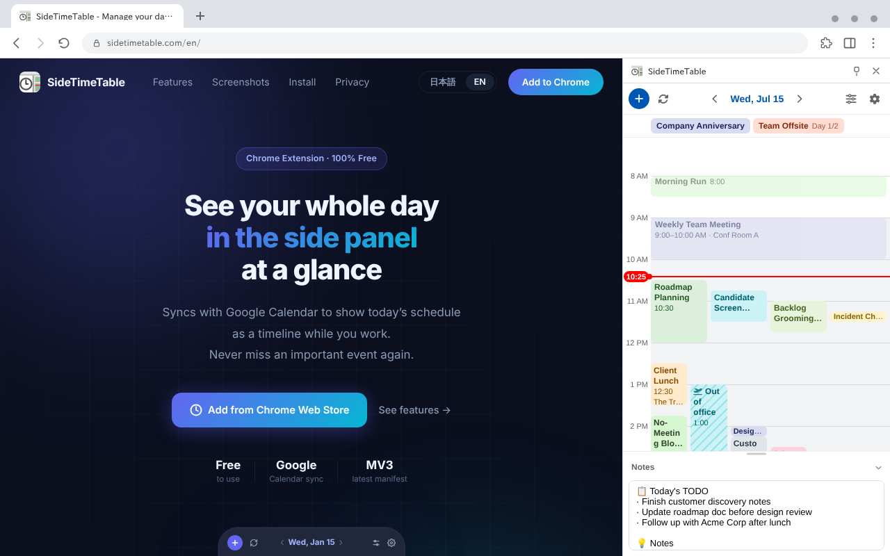

# SideTimeTable

## English

**SideTimeTable** shows your day as a timeline in Chrome's side panel, so your schedule stays next to whatever you're working on. It works with Google Calendar, or on its own without an account.

### Features
- **Google Calendar** — Show several calendars at once and switch between groups. Create, edit, and delete events from the panel, with guests, Google Meet links, out-of-office events, and RSVP.
- **Local events** — Add one-off or recurring events (daily, weekly, monthly, weekdays), or drag on the timeline to create one.
- **Reminders** — Desktop notifications before events. Click one to jump to the event or open its meeting link.
- **Make it yours** — Memo panel, color themes (with color-vision presets), dark mode, work hours, 12/24-hour time, English and Japanese.

### Install
Get it from the [Chrome Web Store](https://chromewebstore.google.com/detail/sidetimetable/pnknjjpncnciijkpdfgfiikmhlmamaid). To build it yourself, see [DEVELOPMENT.md](./DEVELOPMENT.md).

### Sponsor
If SideTimeTable is useful to you, you can support its development through [GitHub Sponsors](https://github.com/sponsors/badfalcon). The extension stays free either way.

### License
[Apache License 2.0](./LICENSE). Third-party notices are in [`THIRD_PARTY_LICENSES.md`](./THIRD_PARTY_LICENSES.md).

---

## 日本語

**SideTimeTable** は、その日の予定を Chrome のサイドパネルにタイムラインで表示する拡張機能です。作業中の画面の横で予定を確認できます。Googleカレンダーと連携でき、アカウントなしでも使えます。

### 主な機能
- **Googleカレンダー** — 複数のカレンダーをまとめて表示し、グループで切り替え。予定の作成・編集・削除もパネルから行え、ゲスト招待、Google Meetリンク、不在予定、出欠の回答に対応。
- **ローカル予定** — 単発・繰り返し（毎日・毎週・毎月・平日）の予定を追加。タイムラインをドラッグしてすぐ作成。
- **リマインダー** — 予定の前にデスクトップ通知。クリックでその予定へ移動、会議リンクも直接開ける。
- **自分好みに** — メモ欄、カラーテーマ（色覚対応プリセット付き）、ダークモード、作業時間、12/24時間表記、日本語・英語。

### インストール
[Chrome ウェブストア](https://chromewebstore.google.com/detail/sidetimetable/pnknjjpncnciijkpdfgfiikmhlmamaid)から追加できます。自分でビルドする場合は [DEVELOPMENT.md](./DEVELOPMENT.md) を参照してください。

### スポンサー
SideTimeTable が役に立ったら、[GitHub Sponsors](https://github.com/sponsors/badfalcon) から開発を支援できます。拡張機能は今後も無料です。

### ライセンス
[Apache License 2.0](./LICENSE)。第三者ライブラリの表示は [`THIRD_PARTY_LICENSES.md`](./THIRD_PARTY_LICENSES.md) にあります。
